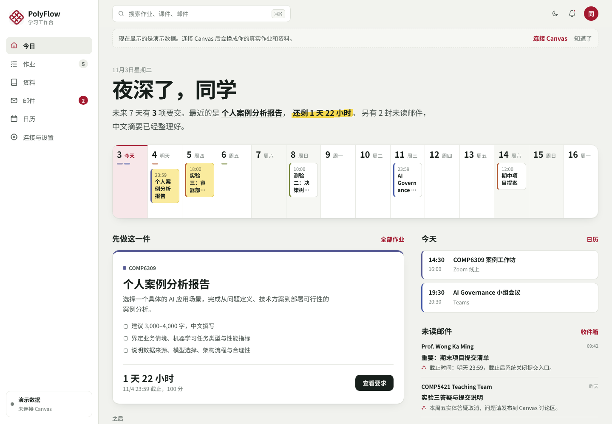
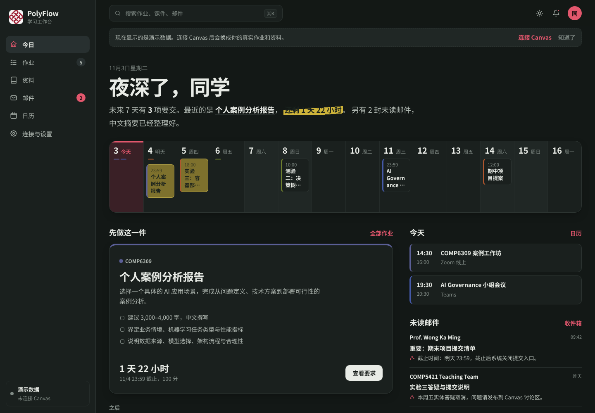
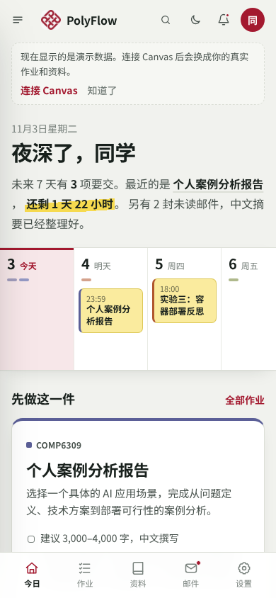
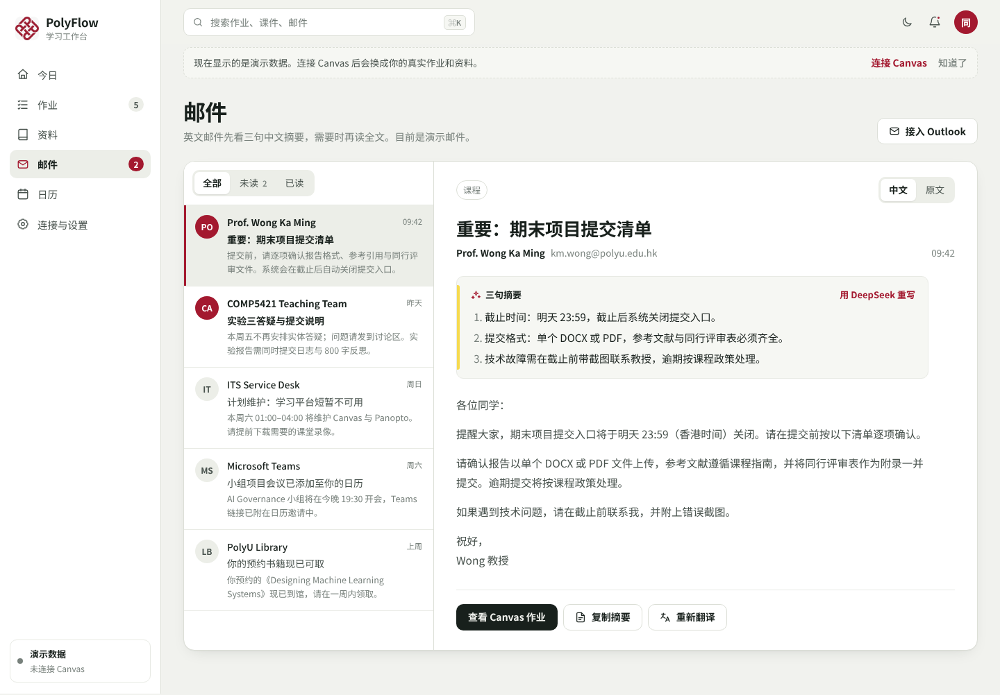

# PolyFlow



一个中文优先的 Canvas / Outlook 学习工作台原型，把作业、课件、邮件与日程放在同一套 Web / PWA 界面中。PolyU 是默认演示配置，Canvas 域名、应用名称和学校名称都可以通过环境变量替换。项目同时提供 DeepSeek 服务端代理：浏览器只调用本站接口，API Key 不会出现在前端代码中。

当前代码是可开源自托管的开箱即用基础版。每个浏览器会话可以在界面中连接自己的 Canvas，Token 使用 AES-256-GCM 加密后保存在服务器；不需要修改 `.env` 或重启。公开发布前仍需要真实账号系统、数据库和更完整的租户隔离，设计见 [docs/ARCHITECTURE.md](docs/ARCHITECTURE.md)。

## 已实现

- 响应式桌面网页与手机端底部导航
- 今日优先级、课程日历、作业详情与完成状态
- 作业搜索、截止时间筛选、课程资料收藏
- Outlook 邮件中文翻译切换与三句摘要
- DeepSeek 重新生成邮件摘要和中文翻译
- DeepSeek 连接状态与连通性测试
- Canvas 官方 API 自动同步课程、作业、提交时间与 Attempt 状态
- Canvas 模块资料同步、启动刷新和 5 分钟自动刷新
- Outlook 两种本机连接方式：浏览器登录 Outlook 网页版，或读取 Mac 上的“邮件”App / Outlook 桌面版与“日历”
- 邮件摘要和翻译按需生成并缓存在本机，可选“打开邮件时自动生成”（默认关闭）
- 本地状态持久化、全局搜索、PWA 离线壳

没有连接时使用演示数据；连接后，Canvas 作业、提交状态、模块资料，以及 Outlook 邮件和日程会替换为实时数据。所有连接都是只读的，不会修改你的学校账号或邮箱。

| 深色模式 | 手机 | 邮件 |
| --- | --- | --- |
|  |  |  |

## 本地运行

需要 Node.js 20 或以上，不需要 `npm install`（项目没有 npm 运行时依赖，Vue 已内置在 `web/vendor/`）：

```bash
git clone https://github.com/clpBlog/polyflow.git
cd polyflow
npm start
```

打开 `http://127.0.0.1:4173`。macOS 上也可以双击 `启动 PolyFlow.command`，它会自动启动服务并打开浏览器。

运行测试：`npm run check && npm test`（离线运行，不需要真实账号）。

### Docker

```bash
cp .env.example .env
docker compose up --build
```

默认只映射到本机 `127.0.0.1:4173`。在有身份认证和每个用户独立凭据存储之前，不要把当前单账号版本直接公开到互联网。

### 启用 DeepSeek

1. 从 DeepSeek 控制台创建 API Key。
2. 复制环境变量模板：

```bash
cp .env.example .env.local
```

3. 在 `.env.local` 中填写 `DEEPSEEK_API_KEY`。
4. 正常启动；服务会自动读取 `.env.local`：

```bash
npm start
```

也可以直接设置临时环境变量：

```bash
DEEPSEEK_API_KEY=sk-... npm start
```

`.env.local` 已被 `.gitignore` 排除，不要提交、截图或发给他人。也可以显式使用 `node --env-file=.env.local server.mjs`。若只是检查交互而不消耗额度：

```bash
DEEPSEEK_MOCK=1 node server.mjs
```

## DeepSeek 接口

| 接口 | 用途 |
| --- | --- |
| `GET /api/integrations/status` | 返回是否已配置密钥、当前模型与演示模式 |
| `POST /api/ai/translate` | 英文邮件翻译为简体中文，返回 JSON |
| `POST /api/ai/summarize` | 生成严格的行动、时间、风险三句摘要 |
| `POST /api/ai/test` | 测试连通性 |

所有 AI 请求都经过输入长度校验、同源限制和简单的每分钟速率限制。正式部署时还应增加身份认证、持久化限流、审计与用量预算。

## 自动同步 Canvas

PolyU 当前禁止学生自行生成 Personal Access Token，因此本地版本提供“本机浏览器会话桥接”：

```bash
python3 -m venv .venv
.venv/bin/pip install -r bridge/requirements.txt
npm start
```

进入“连接与设置 → Canvas”，点击“使用本机浏览器登录”。PolyFlow 会打开一个独立的 Chrome 窗口：

1. 你在 PolyU ADFS 官方页面自行输入账号、密码和 MFA。
2. 登录成功后页面会自动同步并关闭临时浏览器。
3. 后续同步复用本机 `.data/canvas-profile` 中的浏览器会话。
4. 页面保持打开时每 5 分钟同步，也可以点击“同步 Canvas”。

桥接不会把 NetPassword 保存到应用数据库。它只在已登录页面内读取 Canvas 同源数据，因此能适应 PolyU 禁用个人 Token 的设置。桥接默认只在本机监听 `127.0.0.1` 时启用；不要在生产服务器或公网 Docker 容器中开启 `CANVAS_BRIDGE_ENABLED=1`。

如果学校允许 Personal Access Token，也可以展开备用方式填写。Token 会绑定到随机 HttpOnly 会话，并使用 AES-256-GCM 加密后保存。管理员仍可用 `CANVAS_API_TOKEN` / `CANVAS_BASE_URL` 配置共享兼容模式，但不建议在多人环境中使用。

系统随后会自动同步：

- 活跃课程
- 作业名称、说明、截止时间与分值
- 真实 `submitted_at`、提交状态与 Attempt 次数
- Canvas 模块中的资料入口

服务端缓存 Canvas 数据 5 分钟。网页启动时自动同步一次，页面保持打开时每 5 分钟刷新；“同步 Canvas”按钮可以强制刷新。`GET /api/canvas/sync?refresh=1` 是强制刷新接口。

不会使用账号密码自动登录 ADFS，也不会替你点击提交。原因是：

- 应用不接收或保存 NetPassword，密码和 MFA 只输入到官方登录页。
- 登录窗口首轮由用户完成，系统只复用本机浏览器会话。
- 数据通过 Canvas 同源 JSON 读取，不依赖页面上的单个按钮或表格布局。
- 浏览器桥接只用于本机，不能作为公共云服务替所有用户保存学校密码。

要让所有用户打开网页就能跨设备同步，仍应向 PolyU IT / Canvas 管理员申请正式 OAuth 接入。

## 连接 Outlook

进入“连接与设置 → Outlook → 连接 Outlook”，两种方式任选其一。两种都只在本机运行、只读，邮件不会上传到任何服务器；只有你点“生成摘要”或“翻译”时，那一封邮件才会发给 DeepSeek。

### 方式一：浏览器登录 Outlook 网页版

和 Canvas 桥接相同：PolyFlow 用 `bridge/outlook_bridge.py` 打开一个独立的 Chrome 窗口，你在微软或学校的官方页面登录并完成 MFA，之后复用 `.data/outlook-profile` 里的浏览器会话，读取最新 40 封收件箱邮件（前 25 封含正文）和未来三周的日历。依赖与 Canvas 桥接相同（`.venv` + `bridge/requirements.txt`）。

- 兼容旧版（`outlook.office.com`，cookie 认证）和 2025 年起的新版（`outlook.cloud.microsoft`，页面内的临时令牌）。桥接会复用页面自己请求时带的认证头，只保存在内存里，不写入磁盘。
- 读取方式是 Outlook 网页版自己调用的 `/owa/service.svc` JSON 接口。它**没有公开文档**，微软改版后可能失效，届时界面会显示“可能是微软改了接口”。
- 排查时可以单独运行：`.venv/bin/python bridge/outlook_bridge.py sync --debug`，原始返回会打印到 stderr。
- 世纪互联版等其他地址可用 `OUTLOOK_BASE_URL` 指定。

### 方式二：读取这台 Mac 上的邮件 App（仅 macOS）

如果你已经在 Mac 的“邮件”App 或 Outlook 桌面版（旧版）里收学校邮件，PolyFlow 用系统自带的 `osascript` 运行 `bridge/mac_mail.js` 读取本机已同步的邮件，日程通过 EventKit 读取“日历”App 中的所有账户（会展开重复课程）。不需要再登录，也不依赖网页接口。

- 第一次读取时 macOS 会询问是否允许“终端”（或启动 PolyFlow 的程序）控制“邮件”/ Outlook、访问日历。若误点了拒绝，到“系统设置 → 隐私与安全性 → 自动化 / 日历”中重新允许。
- 新版 Outlook for Mac 不支持 AppleScript，需在 Outlook 菜单中关闭“新版 Outlook”，或改用“邮件”App / 方式一。
- 可以单独测试：`osascript -l JavaScript bridge/mac_mail.js mail`（或 `outlook`）。

### 多用户部署（未来）

上面两种方式都依赖本机浏览器或本机 App，不适合公共服务器。要做成多人可用的服务，建议采用 BFF（Backend for Frontend）架构：

1. `polyflow-api` 服务端保存 Canvas 访问令牌和 Microsoft OAuth refresh token。
2. Outlook 通过 Microsoft Entra 注册应用，仅申请 `Mail.Read` 与 `Calendars.Read` 权限。
3. Canvas 使用学校允许的 API 访问方式按课程范围读取作业、模块和文件元数据。
4. 服务端从 Canvas / Graph 拉取数据、去重并生成统一模型，再提供给前端。
5. DeepSeek 只接收完成业务所需的最少文本；在发给第三方模型前确认学校的数据分类、跨境传输与日志保留政策。
6. 提供“撤销连接”和“清除缓存”入口，并记录用量、错误与预算上限。

不要把 Canvas Token、Microsoft Client Secret 或 DeepSeek API Key 放进浏览器代码、URL 或公开仓库。

## 界面（Vue 3）

新版界面在 `web/` 目录，用 Vue 3（`web/vendor/` 内置 3.5.40 浏览器版）以原生 ES 模块运行，不需要 `npm install`，也没有构建步骤：改完 `web/src` 里的文件刷新浏览器即可。

- 首页：两周截止时间轴、今天最该做的一件事、今日日程与未读邮件摘要
- 作业按“已逾期 / 今天 / 明天 / 本周内 / 之后”分组；资料按课程颜色区分
- 支持浅色、深色和跟随系统；桌面与手机布局；`⌘K` 或 `/` 打开全局搜索
- 演示数据的日期相对今天生成，任何时候打开都是“最近”的样子

`server.mjs` 默认服务 `web/`。需要临时切回旧版单文件界面时：`POLYFLOW_UI=legacy npm start`。

```text
web/index.html            Vue 入口与 import map
web/src/main.js           启动、路由、自动同步
web/src/store.js          全局状态、Canvas / DeepSeek 接口调用
web/src/demo.js           演示数据
web/src/views/            今日、作业、资料、邮件、设置五个页面
web/src/components/       截止时间轴、作业行、资料卡、弹窗等组件
web/styles/app.css        设计变量与全部样式
web/vendor/               Vue 运行时（MIT 许可）
```

## 文件结构

```text
index.html           旧版应用外壳（POLYFLOW_UI=legacy 时使用）
styles.css           桌面与手机端视觉样式
app.js               演示数据、页面渲染、Canvas 同步与交互
server.mjs           静态服务器、Canvas / DeepSeek 代理与限流
manifest.webmanifest PWA 元数据
sw.js                离线壳缓存
.env.example         DeepSeek 环境变量模板
Dockerfile           可自托管镜像
docs/ARCHITECTURE.md 多用户与开源部署架构
SECURITY.md          安全边界和部署限制
```

## 上线前检查

- 向 PolyU IT 与课程教师确认第三方 AI、邮件和课程数据的连接范围。
- 配置 HTTPS、身份认证、CSRF 防护与会话安全。
- 为 DeepSeek 设置独立预算和用量告警，并关闭不必要的原文日志。
- 接入真实 Canvas / Graph 前，用真实数据类型完成隐私影响评估。
- 完成 `docs/ARCHITECTURE.md` 中的多用户改造清单。

## 许可证

代码以 [MIT License](LICENSE) 发布。`web/vendor/` 中的 Vue.js 同为 MIT 许可。

`assets/polyu-logo.png` 与 `web/assets/polyu-logo.png` 是香港理工大学的校徽，属于其所有者的商标，**不在 MIT 授权范围内**，仅用于标识默认的演示配置。本项目与香港理工大学没有隶属或背书关系。Fork 或再发布时请替换为你自己的图标。
